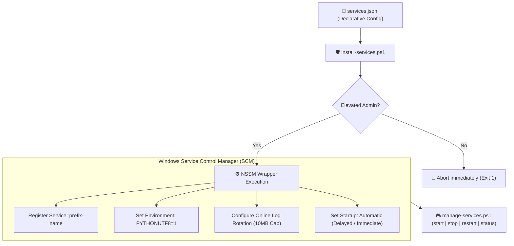

<div align="center">

# ⚙️ nssm-service-kit
### Production-Hardened Windows Services Automation with NSSM & PowerShell

[](https://microsoft.com/powershell)
[](https://microsoft.com/windows)
[-orange.svg)](https://nssm.cc)
[](https://github.com/Kaio-Comk/nssm-service-kit)
[](https://opensource.org/licenses/MIT)

**Declarative JSON-driven Windows service orchestration for Python, Node.js, and background daemons.**  
*Strict elevation verification, online log rotation, batch prefix management, and zero silent failures.*

[Why This Kit](#-why-fail-loudly) • [Architecture](#-architecture) • [JSON Configuration](#-configuration-schema) • [Operations Cheatsheet](#-operations-cheatsheet) • [Best Practices](#-production-lessons-baked-in)

</div>

---

## ⚡ Why "Fail Loudly"?

On Windows, standard management scripts frequently hide catastrophic errors:
* Running `Restart-Service -ErrorAction SilentlyContinue` without elevated Admin rights exits with code `0`, giving a false sense of success while the service **continues running old, broken code**.
* `nssm-service-kit` strictly enforces:
  1. **Pre-flight Elevation Check:** Immediately halts execution if not running in an elevated Administrator session.
  2. **Non-Zero Exit Codes:** Every failed step throws an actionable, visible error.
  3. **Dry-Run Mode (`-DryRun`):** Allows inspecting what would be configured without administrator privileges.

---

## 🏗️ Architecture



---

## 📋 Configuration Schema

Describe all your system services in a clean, version-controllable JSON file (`services.json`):

```json
{
  "prefix": "myapp",
  "python": "C:\\myapp\\.venv\\Scripts\\python.exe",
  "logsDir": "C:\\myapp\\logs",
  "services": [
    {
      "name": "worker",
      "script": "C:\\myapp\\workers\\queue_worker.py",
      "description": "MyApp Background Job Worker"
    },
    {
      "name": "api",
      "script": "C:\\myapp\\api\\server.py",
      "description": "MyApp FastAPI Gateway"
    }
  ]
}
```

> **Prefix Isolation:** Services are automatically registered as `<prefix>-<name>` (e.g., `myapp-worker`, `myapp-api`). Multiple deployments or environments (staging, production) can run side-by-side on the same Windows machine without collision.

---

## 💻 Operations Cheatsheet

### 1. Install or Update Services (Elevated PowerShell)
```powershell
# Validate configuration safely first (Dry-Run)
.\scripts\install-services.ps1 -Config .\services.json -DryRun

# Apply and register with Windows Service Control Manager
.\scripts\install-services.ps1 -Config .\services.json
```

### 2. Batch Lifecycle Management
Manage all services matching a prefix at once:
```powershell
# Check live status across all prefix services
.\scripts\manage-services.ps1 -Action status -Prefix myapp

# Gracefully restart all services
.\scripts\manage-services.ps1 -Action restart -Prefix myapp

# Stop all services
.\scripts\manage-services.ps1 -Action stop -Prefix myapp
```

---

## 🛡️ Production Lessons Baked In

* **Online Log Rotation:** Never truncate a file a running Windows process holds open. The installer configures NSSM's native log rotator (`AppRotateFiles 1`, `AppRotateBytes 10485760`) to rotate files cleanly while active.
* **UTF-8 on Windows:** Automatically injects `PYTHONUTF8=1` into the service environment to eliminate Windows `cp1252` encoding exceptions on emojis and unicode text.
* **LocalSystem Isolation:** Services running under `LocalSystem` share `%TEMP%`. The kit enforces unique working directories and log paths per service to prevent session collision.

---

## 📄 License

Distributed under the **MIT License**. See `LICENSE` for details.

<div align="center">
  <sub>Built with ❤️ by Kaio Lima. If nssm-service-kit simplified your Windows DevOps, please give it a ⭐!</sub>
</div>
